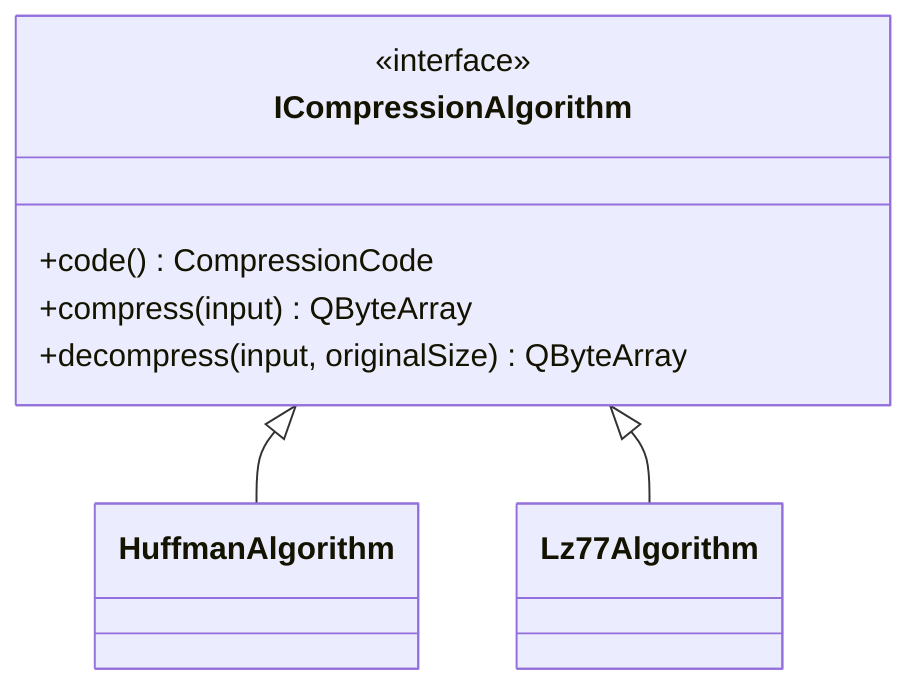

# 课程压缩算法与备份集成

2026-10-25，按用户提供的三份资料实现，无外部压缩库依赖：

| 资料 | 采用的方法 |
| --- | --- |
| [7.压缩解压及其关键技术](../ref/7.压缩解压及其关键技术.pdf)，第 44—62 页 | 按 256 种字节统计频率，小顶堆建 Huffman 树，左 0 右 1，真正的比特打包；保存词频和有效位数，再建树解码 |
| [实验指导书-压缩解压](../ref/实验指导书-压缩解压.pdf)，第 5—9、10—13 页 | Huffman 的频率表方案；LZ77 的滑动窗口及四字节 `(距离, 长度, 下一字节)` 记录，支持重叠复制 |
| [《打包解包技术》实验指导](../ref/《打包解包技术》实验指导.pdf)，第 3—8、12—14 页 | 将类型/路径/长度等记录与内容分离，父目录先于子项；只向空目录还原，目录元数据最后恢复，链接不跟随 |

当前交付是压缩备份和自动解压还原。既有 JSONL 清单负责路径、类型和元数据；`.data` 保存普通文件内容，组内硬链接只保存一份。未增加独立归档导入/导出，也不宣称与课件的示例文件格式兼容。课件的原生 C 结构体布局和 `long` 大小依赖编译器，本实现使用固定宽度整数和大端字节序；保留现有 SHA-256 校验及目录 fd 路径保护。

## 用户操作和兼容

在“备份目标”编辑目标，选择“不压缩 / Huffman（字节频率编码）/ LZ77（滑动窗口编码）”并保存。默认不压缩。策略保存于 Agent 的目标配置，每次备份使用开始时的快照；同一仓库可以保留多种算法和未压缩版本。修改设置不重写历史数据，还原只按版本和清单中的算法解码。

启用压缩将配置升级为格式 7，旧 Agent 必须拒绝该配置；添加任务不能将格式降级。未压缩新版本仍为格式 4，压缩版本为格式 5；新客户端继续读取格式 1—4。新 Agent 在上传前要求 Server 回执确认算法；旧 Server 不支持时明确失败。Server 和客户端均须更新并重启。

## 算法实现

2026-10-26 按课件补齐统一接口：`ICompressionAlgorithm` 声明虚析构函数和纯虚 `compress()` / `decompress()`，`HuffmanAlgorithm`、`Lz77Algorithm` 分别使用 `override` 实现。接口保留项目的有界字节块参数和 `Error` 异常约定；文件读写、网络传输及版本提交仍由原有模块负责。

`selectCompressionAlgorithm()` 是唯一识别算法名称并选择具体实现的工厂入口，返回生命周期覆盖程序的只读基类引用。两种实现不保存调用状态，词频树、字典和缓冲均属于本次调用，可由不同工作线程使用。策略解析也通过工厂验证名称；未知名称明确失败，`none` 仍由备份流程直接写原文。

块封装层通过 `codec.compress(input)` 和 `codec.decompress(payload, originalSize)` 执行虚函数调用，仅负责压缩收益判断、原文回退、块头和摘要验证。稳定的磁盘编号由接口 `code()` 返回，`CompressionCode` 枚举定义 Raw=0、Huffman=1、Lz77=2；封装层不包含 Huffman/LZ77 的选择分支。新增算法时需要实现接口、在工厂登记名称，并为新格式确定稳定编号；已有 `BC01` 数据及格式 5 不重写。

代码位置：`include/backup/core/compression_algorithm.h` 定义接口和工厂声明；`src/core/compression_algorithm.cpp` 实现工厂；`src/core/compression_algorithms.h` 声明具体实现类；`src/core/compression.cpp` 管块封装。

`src/core/huffman.cpp` 按每个数据块的字节频率建树，相同频率按节点插入顺序排序，因此编码和解码结果与平台无关。节点由容器管理，无裸指针所有权。频率表是 256 个 u32；其后保存 u32 有效位数和按最高位优先编码的字节。末字节补零，解码检查补位、频率总数、完整码字及各符号实际计数。单一符号使用一位零码；空文件不产生块。

`src/core/lz77.cpp` 使用最多 65535 字节的后向字典和最多 255 字节的匹配长度。三字节哈希链最多搜索 64 个候选，限制重复和恶意数据的匹配开销；无足够匹配时输出字面量。每个记录保存 u16 距离、u8 长度、u8 下一字节；解码从不断增长的输出中复制，正确支持距离小于长度的重叠匹配。每个块重置字典，因此不会引用其他文件或其他数据块。

两种算法均对最多 256 KiB 的原文块处理。Huffman 在块内完成统计和编码两次遍历，无需重读整个源文件。LZ77 的字典、哈希链和输出也受该块大小约束；不将整个文件载入内存。若算法负载不小于原文，整块改用原文编码，额外开销仅为 45 字节公共头。

## 磁盘格式与校验

每个压缩 `.data` 文件由独立块连续组成；空文件的 `.data` 长度为零。

| 偏移 | 长度 | 含义 |
| --- | --- | --- |
| 0 | 4 | 魔数 `BC01` |
| 4 | 1 | 本块实际编码：0 原文、1 Huffman、2 LZ77 |
| 5 | 4 | 原文长度，u32 大端，1—262144 |
| 9 | 4 | 负载长度，u32 大端，不超过原文长度 |
| 13 | 32 | 本块原文 SHA-256 二进制值 |
| 45 | 负载长度 | 原文或所选算法编码后的数据 |

格式 5 的普通文件清单记录 `compression`、`size`、`sha256`、`stored_size`、`stored_sha256`；其他节点不带压缩字段。`size/sha256` 指原文，`stored_size/stored_sha256` 指整个编码文件。`stored_bytes` 为实际内容文件字节数之和，不含清单、警告、删除回执和文件系统开销，也不代表逻辑大小与物理磁盘占用等量。

Agent 继续按原文偏移上传，Server 在每次有界写入前压缩；完成文件时核对原文长度和 SHA-256，同步编码内容后记录清单。只有整个版本持久化完成才发布。网络流量仍是原文分块；本次没有实现传输压缩。

还原按编码字节偏移下载，先验证头和长度，再逐块解码。下载包可以跨块或包含多个块，缓冲不超过 `2 × 256 KiB + 45` 字节。每块验证原文 SHA-256；每个文件再次核对原文和编码内容的总长度及摘要，最后才无覆盖发布。未知算法、越界长度、无效词频、非法距离、截断和尾随数据均失败；错误带路径，其他已完成文件作为部分还原报告。解压长度不能超出清单，失败临时文件按现有还原流程清理。

## 验证入口

`compression-test` 检查二进制往返、频率并列、单符号、比特补位、重叠匹配、原文回退和畸形输入；还直接通过基类引用验证两种实现、输入边界，以及重构前六个块样本的完整编码摘要，防止只验证新编解码器之间能相互配合。`backup-compression` 检查真实存储节省、新旧版本混用、链接/FIFO/空文件、重启、损坏和传输失败。`compression-streaming` 比较两种算法在 64 MiB 与 1 GiB 数据上的实际内存和还原结果。桌面回归覆盖策略保存、版本标签、两个窗口尺寸和真实解压还原。命令和实际结果另记于 [测试报告](test-report.md)。
