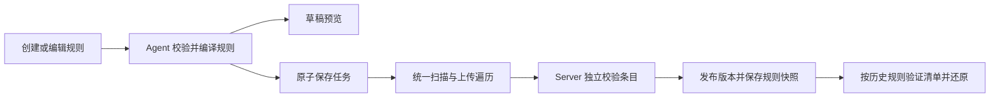

# 六类自定义备份

2026-11-02，实现 FR-11 和 UC-08 的手动备份链路。当时没有增加实时触发；2026-11-17 已在本地实时备份链路复用相同规则，新增自动版本排除条件验证，见[实时备份说明](realtime.md)。

## 操作入口

新建任务的“自定义备份”区域提供路径、类型、名字、时间、尺寸、用户六个页签；每类可以添加多条选入或排除条件。已有任务点击卡片上的“自定义备份筛选”按钮，可预览草稿范围，再保存或取消。预览不修改任务，另记为“筛选预览”执行记录；原有扫描结果仍代表正式规则。

路径相对于任务根目录，多个显式来源的还原路径可在来源列表查看。目录路径如 `sub/` 包含子树；`*` 和 `?` 本身不匹配 `/`。名字只匹配最后一段，区分大小写，通配符也适用于中文及带换行的合法文件名。类型规则进一步限制上方可备份类型，不会自动启用设备节点。硬链接成员指源文件 `st_nlink > 1`，先筛选再选择组内代表，未入选的其他链接不会进入版本。

时间使用修改时间，界面按本地时间输入，保存为 UTC Unix 秒；尺寸单位为字节，使用十进制字符串保留 64 位精度。两个范围都包含边界，可只填一端。目录忽略尺寸选入条件，软链接/FIFO 不匹配尺寸选入。用户使用数值 UID，多 UID 分别添加；不查询远端用户名。

## 组合与目录

同类选入取或，跨类选入取且，没有选入限制时匹配全部受支持条目；任意排除命中即拒绝。任意类别排除目录时不遍历其子树，即使后代被显式选择，也不能通过结构父目录绕过排除。

只为实际入选条目补齐必要父目录，父目录可不满足选入条件。保留空目录时，未被排除且符合目录适用条件的目录可保留，其结构父目录也一并保存；关闭保留时仅保存包含入选非目录后代的目录。Server 发布和 Agent 还原前均拒绝没有入选后代且自身不匹配的目录。没有匹配条目可产生空版本。链接不跟随，FIFO 和设备不读取内容。

## 接口与数据流

`include/backup/core/backup_filter.h` 定义 `FilterEntry` 和 `IBackupFilter`，基类有虚析构、纯虚 `category()` 和 `matches()`。`src/core/backup_filter.cpp` 的 `PathFilter`、`TypeFilter`、`NameFilter`、`TimeFilter`、`SizeFilter`、`UserFilter` 分别实现条件；`makeBackupFilter()` 集中校验和选择具体类，路径/名字表达式在构造时编译。新增类别需要实现接口、登记工厂及类别编号，并增加界面和测试。

`SourceScope` 编译并持有共享只读规则，调用 `filter->matches(entry)`，负责组合，不逐条重新解析 JSON。规则对象不保存文件状态或操作缓冲。扫描与上传共用 `sourceTree()`；Server 接收条目、Agent 还原清单均调用相同的规则逻辑校验。被选中普通文件的内容仍按现有 SHA-256 和有界块流程处理，支持与 Huffman/LZ77 压缩策略组合。

IPC：创建/来源检查支持可选 `filters`；`update_task_filters {id, filters}` 只替换规则；`start_filter_preview {task_id, filters}` 使用当前来源与草稿规则异步预览。执行期间禁止编辑任务，工作线程继续使用开始时的快照。校验或 QSaveFile 保存失败时原内存与有效配置不变。清空规则不降级配置；有效规则至少要求格式 6，已有压缩格式 7 保持不变。

每个版本保存 `filters` 及 `rules.filters`，两者必须一致；后续任务更改不重写历史清单。还原允许显式来源被历史规则排除，空版本也可还原。带条件的条目必须具有 UID 和修改时间，不将缺少的元数据默认为 UID 0。设备节点也记录校验用元数据，清单格式 4/5 校验其范围；不因此增加设备内容读取或设备元数据恢复承诺。

## 校验与验证边界

选入/排除各最多 100 条，总 JSON 不超过 16 KiB；模式最多 512 字符。拒绝绝对路径、`.`/`..`、空路径段、非法类别/类型/UID、负尺寸、倒置或越界区间、缺少边界和未知规则字段。

`backup-filter-test` 直接通过基类指针验证六种实现、通配、Unicode、闭区间、UID 组合和非法输入。`backup-custom-filter` 对照需求附录 B 比较真实扫描、版本清单和还原树，还验证显式来源剪枝、硬链接、草稿隔离、原子保存失败、重启、压缩组合及损坏规则拒绝。无 chown 权限时明确记录其他 UID 真文件场景的限制，不把替代条件当作附录 B-02 完整通过。`desktop_custom_filter.mjs` 覆盖六个页签、创建/编辑、预览、无效尺寸、重载、两种窗口布局和真实备份还原；它接入完整窗口回归。

命令、实际结果和未测边界见 [测试报告](test-report.md)。本轮未测百万条目规模及物理掉电，不宣称全覆盖。
